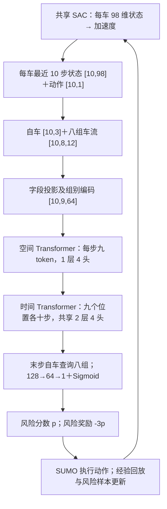

# 无信号交叉口的空间与时间 Transformer 风险预测方案

本仓库已实现 P2 的独立时空风险器，并在目标 Linux + RTX 4090 环境通过聚焦测试；P0/P1/P2 修订版已通过目标环境验收，P3 已提供 B0/M1 可选接入入口，本轮服务器接入验收待完成；尚无新模型独立性能结果。目标是在原多车共享 SAC 决策系统中，把风险预测器整体重构为“空间 Transformer → 时间 Transformer → 自车条件读出”，检验八组聚合车流的同刻关系及逐组历史变化，是否改善风险识别和闭环安全效率权衡。空间层处理车流**组**，不是单辆周车轨迹；任何收益均待实验验证。

**实施设备约束：**新方案的环境复核、代码修改、训练和实验统一基于 Linux 系统与 NVIDIA GeForce RTX 4090 GPU；具体发行版、驱动、CUDA、PyTorch 和 SUMO 版本在 P0 记录并锁定。

## 从哪里读起

1. [精简方法稿](chapters/03_methods_experiments_brief.md)及其[Word 文档](chapters/03_methods_experiments_brief.docx)：3.1–3.3 独立介绍任务、张量流与核心公式；3.4 保持既定原文。
2. [完整方法稿](chapters/03_methods_experiments.md)：字段切片、两个 Encoder 的连接、注意力公式、风险奖励和新增消融。
3. [实施规范](research_implementation_plan.md)：原代码事实、模型接口、标签与填充协议、实施阶段、复现要求。
4. [阶段状态](plan/stage-gates.md)、[证据映射](plan/evidence-map.md)、[方法实验追踪](plan/review/method-experiment-traceability.md)：区分研究假设与已取得证据。
5. [原论文](https://arxiv.org/abs/2510.12428)与[原源码](https://github.com/hank111525/SAC-RWB)：研究设计的事实依据。`references/` 是本地只读快照，不随公开仓库分发。

## 技术路线

原风险器将每步 99 维输入直接嵌入为一个 128 维时间 token。新方案将自车和八组车流保持为九个 token，先在同一时刻交换信息，再按相对组别位置追踪十步，最后压缩为一个动作条件风险分数。该设计沿用原逐车风险评分和共享 SAC 决策接口，内部网络、训练样本有效性检查与公平对照需要重新实施。近期偏置只在时间注意力中使用，并须有无偏置消融。

风险分数是 `[0,1]` 数值，不自动等于实际碰撞概率。原缓冲区含未执行动作的伪安全样本，原组别旋转还可能重复和漏组；共同数据与环境修复是所有模型比较的前提。标签需按真实执行动作和锁定的未来观察窗定义，校准须在自然事件比例的独立数据上核验。

## 文件组织与保护边界

| 路径 | 用途与状态 |
|---|---|
| `chapters/` | 两份 Markdown 方法稿均止于 3.4 节；两份 3.4 原文按要求逐字保留。精简稿的 3.1–3.3 独立介绍当前方法。对应 Word 置于同目录。扩展消融见 `plan/experiment-protocol.md`。 |
| `research_implementation_plan.md` | 当前详细技术规范；独立模型实现状态见 `plan/p2/README.md`。 |
| `plan/` | 范围、大纲、阶段门槛、证据和方法实验追踪。 |
| `scripts/verify_plan.py` | 静态检查文档、两份章节 3.4 原文、保护目录哈希与链接；不运行 SUMO。 |
| `references/` | 本地原论文、原始源码及场景快照；只读，且不随公开仓库分发。原始来源见上方链接。 |
| `output/` | 已按用户要求删除；Word 导出稿位于 `chapters/`。 |
| `src/` | 从原源码复制的独立工作副本；保留 P1 的原时间风险器，并新增 P2 时空风险器，P3 接入已在工作副本实现，目标环境验证待完成。 |

实施顺序为 P0 参考环境复核、P1 所有组共同的输入及训练缺陷修复、P2 时空风险器实现、P3 SAC 在线接入、P4 真实标签与数据审计、P5 多种子独立对照。P0、P1 和 P2 修订版已于 2026-11-20 通过目标环境验收，35 项测试无跳过，完整证据已回传；P3 本地接入已开始，服务器验证待完成。P2 历史证据范围见 [P2 记录](plan/p2/README.md)。请从 [阶段状态](plan/stage-gates.md) 判断每阶段是否实际完成，不要从文档图示推断模型已经运行。

## 静态验证

在项目根目录执行 `python scripts/verify_plan.py`。脚本核对当前设计术语、两份 3.4 节原始哈希、`output/` 是否已删除以及本地链接；若本地存在 `references/`，还核对其保护基线哈希。它不会训练模型，也不能替代风险预测或闭环实验。远端 P0 运行日志与工作副本保留在本地 `plan/p0/remote-run/`，不随公开仓库分发。

P3 的接口、时延定义和服务器步骤见 [P3 记录](plan/p3/README.md)。
