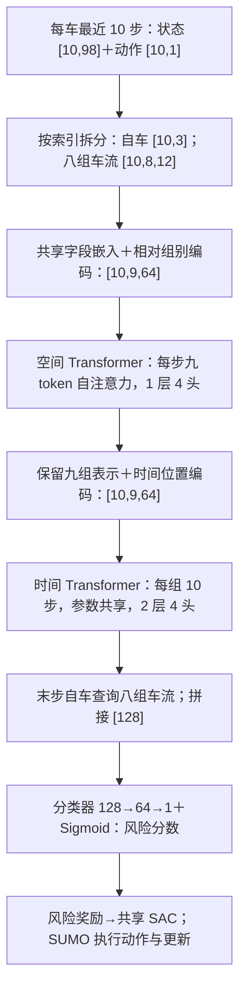

# 第三章 时空风险引导的无信号交叉口决策

## 3.1 研究背景与问题

无信号交叉口中，车辆需在安全与通行效率之间选择纵向加速度。原方法以共享 SAC 策略控制多辆受控车，风险器先把每车最近 10 次的完整状态与动作整体线性映射，再用带固定近期偏置的时间 Transformer 输出风险分数。尽管 98 维状态包含八组车流的队列、等待和路口内部占用，原风险器在注意力计算前已把每个时刻压为一个向量，因而没有显式保留各组关系随时间演化的表示。

本文把风险器重构为空间与时间分轴建模的整体架构：每步形成自车及八组车流共九个 token，空间 Transformer 在同一时刻更新组间关系，时间 Transformer 沿每个 token 位置追踪最近 10 步，最后以包含所选动作的自车表示读出风险。八组 token 是聚合车流统计，不是八辆周车；现有观测无法支持逐车轨迹交互、准确的让行因果关系或已校准碰撞概率的主张。空间与时间分轴注意力已有研究先例，本研究待检验的内容是它在这一聚合观测和闭环风险反馈任务中的实际增量。

## 3.2 原方法与改进方法

每辆受控车进入路口前 30 m 控制区时获得 $s_t\in\mathbb R^{98}$。它依次包含自车归一化距离、速度各 1 维，八组队列各 1 维、八组等待各 1 维，以及八组各 10 个二值路口占用格。组别按自车方向取相对顺序。对历史中第 $t$ 步及组 $g\in\{0,\ldots,7\}$，按原向量的三个非连续区段提取

$$
e_t=(s_t[0],s_t[1])\in\mathbb R^2,\qquad
f_{t,g}=\big(s_t[2+g],s_t[10+g],s_t[18+10g:28+10g]\big)\in\mathbb R^{12}.
$$

方括号中的切片采用零基索引，第三项是 10 个占用格。历史动作使用当时实际执行的加速度；当前步放入正在评分的加速度 $a_t$。自车和组别分别嵌入到 $d=64$ 维：

$$
x_{t,0}=W_e[e_t;a_t]+b_e+u_0,\qquad
x_{t,g+1}=W_f f_{t,g}+b_f+u_{g+1},\qquad
X_t=[x_{t,0},\ldots,x_{t,8}]\in\mathbb R^{9\times64}.
$$

$W_e\in\mathbb R^{64\times3}$、$W_f\in\mathbb R^{64\times12}$ 为共享投影，$u_0$ 区分自车，$u_{g+1}$ 区分八个相对车流位置。组嵌入仅表达已核验的相对组别语义；不根据未知的道路冲突关系预设硬掩码。空间 Encoder 对每个时刻的九个 token 使用一层四头自注意力、前馈层、残差连接和层归一化。每头维度为 16：

$$
A^{S,h}_{t,i,j}=\operatorname{softmax}_{j=0}^{8}
\left(\frac{(W_Q^h x_{t,i})^\top(W_K^h x_{t,j})}{\sqrt{16}}\right),\qquad
H^S_t=\operatorname{Encoder}_S(X_t)\in\mathbb R^{9\times64}.
$$

空间层保留九个更新后的 token，而不在此处汇总成单一场景向量。各位置 $g\in\{0,\ldots,8\}$ 沿时间组成长度 $T=10$ 的序列，加入时间位置编码 $P_t$ 后，送入**共享参数**的两层四头时间 Encoder：

$$
H^T_{:,g}=\operatorname{Encoder}_T
\big(H^S_{1,g}+P_1,\ldots,H^S_{T,g}+P_T;M\big)
\in\mathbb R^{10\times64}.
$$

时间注意力只在同一 token 位置的有效历史步之间计算。沿用原风险器的固定近期偏置时，每头的分数为

$$
A^{T,h}_{g,i,j}=\operatorname{softmax}_{j}
\left(\frac{(Q^h_{g,i})^\top K^h_{g,j}}{\sqrt{16}}+
\beta\big(j-(T-1)\big)+M_j\right),\quad \beta=0.2.
$$

这里 $M_j$ 对有效步取 0、对左侧填充步取 $-\infty$；近期偏置不是因果掩码。预测时输入只到当前步，因此末步读出不会看到真实未来。空间层先让同一时刻各组交换信息，时间层再保留各组的变化轨迹；两个模块通过完整的 $[10,9,64]$ 表示连接，而非把一个模块的单向量结果简单叠加到另一个模块。两类 Encoder 的前馈隐藏宽度暂取 128，并均采用层归一化与残差；宽度与层数是待比较的初始配置。

取最后一步的自车表示 $h_e=H^T_{T,0}$ 和八组表示 $h_g=H^T_{T,g+1}$，以自车作为查询做四头交叉注意力读出：

$$
c=\operatorname{MHA}(q=h_e,K=[h_0,\ldots,h_7],V=[h_0,\ldots,h_7])\in\mathbb R^{64},\qquad
p_t=\sigma\!\left(\operatorname{MLP}_{128\to64\to1}([h_e;c])\right).
$$

该读出不再更新九个 token，只将最终表示压成一个风险分数。风险器的外部输入仍是每车 $[10,98]$ 状态与 $[10,1]$ 动作，输出为 $[0,1]$ 分数；内部的原 $99\to128$ 单 token 嵌入和原末步分类头已被整体替换。64 维、一层空间层、两层时间层及四头是待验证配置，参数量和时延需与对照模型实测。

## 3.3 数据与训练流程

原训练脚本以车辆 ID 保存各受控车历史，车辆到达或碰撞时把其最后 10 步记录放入安全池或风险池；每个有效风险批次从两池各抽 64 条，用 BCE 更新。共享 SAC 先对当前受控车选动作，风险器根据当前状态和已选动作给分，SUMO 执行动作时以 $r_t^{\mathrm{risk}}=-3p_t$ 加入风险惩罚，再将各车转移写入 SAC 回放池。达到原触发条件时先更新 SAC，再尝试风险器训练。新架构保持逐车评分和共享策略的外部连接，但风险器内部改为九 token 空间编码、逐组时间编码和末步读出。

现有终局标签只对车辆最后的历史窗口提供结局监督，不能自动证明更早控制时刻的分数是已校准碰撞概率。原缓冲区还将碰撞样本的末次动作改为 $-3$ 并直接赋安全标签，没有在 SUMO 中执行该替代动作；这种伪安全样本不构成反事实监督。设计验证阶段应统一排除该伪标签，并为所有风险器使用同一个明确的预测事件、样本窗口与分组划分。建议主协议按每个实际决策时刻形成样本，以未来固定 $H$ 步内的真实碰撞为标签；提前成功驶离记为无碰撞，观测不足且无结局的窗口标记为删失。$H$ 需在训练前锁定，不能与历史长度 $T=10$ 混同。由已执行动作及后续策略产生的标签只支持观测策略下的条件预测，不能把未执行加速度的分数直接解释为因果反事实。

原在线短历史重复最早状态填充、终局训练窗口左侧补零；新协议需统一左侧填充并传递有效步掩码 $M$，所有对照使用相同处理。模型运行前应统一修复参考源码八组旋转索引使用模 7 而重复或漏掉车流组的问题，并在工作副本中应用于所有组。上述共同数据与环境修复不计为新架构的性能贡献。

## 3.4 实验设计与判读

实验拟在同一 SUMO 无信号交叉口中进行。各组使用相同路网、交通需求、受控车辆范围、动作边界和独立测试流。

**系统基线。** 无风险奖励 PPO（P0）作为连续动作强化学习参照，使用与下述无风险 SAC 消融组相同的状态、动作空间、基础奖励和训练动作预算。先到先行规则（R0，FCFS）按受控车到达控制区的时间排序，在冲突允许时依次放行。Dawei Wang 等（2025）的混合交通控制方法（W0）让受控车分别作“Go/Stop”离散决策，并在冲突车流同时请求通行时按等待时间和排队情况进行规则裁决。

**消融实验。** 完整模型（M1）使用动作条件八车流空间注意力、近期偏置时间 Transformer 和风险奖励。无风险 SAC（S0）去掉风险预测器及风险奖励，检验整个风险反馈分支的作用；无空间注意力组（B0）保留时间风险器，检验新增空间模块的整体增量；无偏置注意力组（A-B）保留空间模块和时间 Transformer，仅将固定近期偏置置零，检验该时间偏置的作用。各学习组使用相同 SAC 状态、动作、基础奖励、训练动作预算与测试流；涉及风险器的组采用相同风险训练协议，分别重新训练并报告参数量、有效更新次数和推理耗时。

**评价指标。** 闭环决策报告物理碰撞数与率、区域平均排队长度（AQL）、平均等待时间（AWT）、平均速度和完成车辆数，各方法采用相同的统计时段；明确碰撞率的计算分母，并报告多次独立实验的均值与波动范围。
