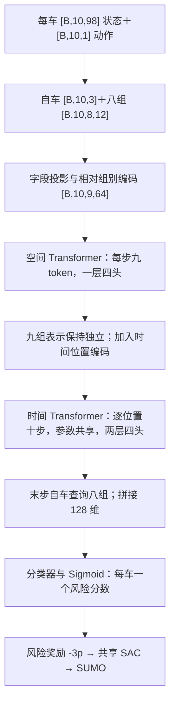

# 无信号交叉口空间与时间 Transformer 风险预测实施规范

> 2026-11-26 状态更新：P0–P4 已按既定工程/数据门槛通过；P5 四组主矩阵在服务器完成，原系统参照 PPO、FCFS、mixed 尚缺，完整 P5 未通过。当前可执行协议见 [P5 协议](plan/p5/protocol.json)及[范围调整](plan/p5/scope-cleanup-20261126.md)。下方 2026-11-22 的“尚无结果/待确认”是当时的历史记录。

> 2026-11-22 新授权：正式实施 P5，具体执行协议为 [p5-v1](plan/p5/protocol.json)，任务、服务器命令与验收门槛见 [P5 说明](plan/p5/README.md)。当前尚无 P5 目标研究结果；此前“待用户确认”的表述保留为准入审查历史。

> 设计版本：2026-11-11。P0/P1/P2 修订版已完成目标环境验收；P0–P3 历史工程基线已验收，P2 的独立时空风险器现已实现，本文件仍是后续接入与实验的技术规范；已有 M1 工程短运行和时延记录，但自然风险更新为 0，尚无独立性能结论。原论文及代码的本地只读快照位于 `references/`，公开仓库当前 Git 已跟踪该快照，仍保持只读；`output/` 已按用户要求删除，目前没有导出稿。

**实施环境约束：**新方案的全部实施工作统一在 Linux 系统和 NVIDIA GeForce RTX 4090 GPU 设备上开展，包括 P0 原系统复核、工作副本中的代码修改、训练、推理测速及对照实验。P0 应记录并锁定 Linux 发行版、GPU 型号与显存、驱动、CUDA、Python、PyTorch、SUMO 和 TraCI 的实际版本；不要把原项目推荐的 Ubuntu 22.04 或当前 Windows 检查环境当作已经验证的新方案运行环境。

> 2026-11-22：当前 P0–P4 修订版已完成最终目标复验，91 项测试无跳过、P4 严格原始数据审计通过。具备进入 P5 的工程和数据条件；仍不构成模型效果结论，P5 未实施，须用户确认。见 [最终记录](plan/review/p5-entry-confirmation-20261122.json)。

## 1. 研究目标与架构定位

本研究在 SUMO 无信号交叉口中沿用多辆受控车共享的 SAC 纵向加速度策略。每车的策略观测为 98 维，风险器使用该车最近 10 次观测与动作输出一个 0～1 分数，再作为奖励惩罚影响 SAC 训练。目标是检验：同一时刻自车与八组聚合车流的关系，及其各自随时间的变化，能否比原时间风险器更有效地表征风险，并改善闭环安全效率权衡。

核心结构是**一条连续的九 token 时空表征流**：字段拆分与语义嵌入 → 每步九 token 空间 Transformer → 九个 token 位置各自的时间 Transformer → 末步自车查询八组 → 风险分类。空间模块不先把八组压成单向量，时间模块也不再沿原 99→128 单 token 嵌入运行。外部仍是每车 `state_seq:[B,10,98]` 与 `action_seq:[B,10,1]` 输入、`score:[B]` 输出；SAC 的 98 维状态、连续动作与逐车接口不变。

八组为四个进口方向上的直行与左转聚合车流。每组有队列、等待和十个路口占用格，**没有**单辆周车 ID、位置、速度或轨迹。本文只能讨论车流组统计之间的关系，不能把九 token 写成九个交通参与者。分轴 Transformer、组别编码和注意力汇聚都有已有研究先例；潜在贡献是它们与当前聚合观测、动作条件风险读出及闭环 SAC 奖励的任务适配和可检验增量，不能宣称新注意力算子或必然的性能提升。

## 2. 原源码的事实基础

静态依据为 `references/SAC-RWB-main/Env.py`、`train_sac.py`、`algos/transformer_risk_model.py`、`sac/SAC.py` 和原论文 PDF。原风险器把 `[B,10,99]` 整体投影到 128 维，加正弦时间位置编码，再用两层四头时间 Transformer 和固定近期偏置处理十步序列。取最后一步送 `128→128→64→1` 分类器及 Sigmoid。原模型在注意力层中只有十个时间 token，八组信息已经混入每步的整体向量。

训练入口先用共享 SAC 为当前受控车选动作，按真实车辆 ID 将状态动作写入风险历史，批量评分后执行 SUMO 动作。环境奖励包含 `risk_reward=-3*score`，各车经验进入 SAC replay；车辆到达或碰撞时，近十步历史按结局进入两池，风险器以 1:1 安全与碰撞小批次做 BCE 更新。在线短序列左侧重复最早记录，终局训练窗口左侧补零，两者不一致。原缓冲区还把碰撞窗口的最后动作改为 `-3`，直接生成安全标签而没有重仿真；这不是有效的反事实样本。

原环境的 `rotated_keywords_order()` 两处分支对八项列表使用模 7，会重复一组并遗漏一组。任何空间 token 模型建立之前，必须在独立工作副本中统一修复并对所有实验组使用同一版本。还须审查 SAC replay 的终止标志、实际优化次数和测试入口；共同修复不得计作新风险器的收益。参考目录始终保持原样。

## 3. 新风险器的输入与数学机制

### 3.1 字段拆分与 token 语义

令时间窗长度 `T=10`，`g=0,…,7` 为相对自车方向的组位置，`s_t∈R^98`、`a_t∈R`。原状态排列为自车两维、八组队列、八组等待、八组十格占用。因此零基索引下

$$
e_t=(s_t[0],s_t[1]),\qquad
f_{t,g}=\big(s_t[2+g],s_t[10+g],s_t[18+10g:28+10g]\big)\in\mathbb R^{12}.
$$

八组的十二维并非原向量中连续排列的八个切片。使用同一组投影权重嵌入各组，并以不同的相对组别编码区分方位及转向；自车 token 将距离、速度和该时刻动作一起编码：

$$
x_{t,0}=W_e[e_t;a_t]+b_e+u_0,\quad
x_{t,g+1}=W_f f_{t,g}+b_f+u_{g+1},\quad
X\in\mathbb R^{B\times10\times9\times64}.
$$

历史步的动作是实际执行值；在线评分当前步用正在考虑或已由 SAC 选出的动作。组别旋转必须在同一车辆的历史中语义稳定。基础方案不使用未经核验的道路冲突硬掩码；可把有可靠路网证据的冲突编码作为独立消融。

### 3.2 空间 Transformer

每个时刻的 `[9,64]` token 独立进入一层四头空间 Transformer Encoder。每头宽度 16，前馈隐藏宽度初设 128；注意力跨九个 token 计算，后接前馈、残差与层归一化：

$$
A^{S,h}_{t,i,j}=\operatorname{softmax}_{j=0}^{8}
\left(\frac{(W_Q^h x_{t,i})^\top(W_K^h x_{t,j})}{\sqrt{16}}\right),\qquad
H^S_t=\operatorname{Encoder}_S(X_t).
$$

自车动作经自车 token 进入空间层；该层可更新自车与车流组，也可更新车流组之间的表示。输出仍为 `[B,10,9,64]`，没有逐时刻汇总。注意力权重表示网络内部连接强度，不直接等同物理冲突或因果解释。

### 3.3 时间 Transformer

同一 token 位置 `g=0,…,8` 的十步空间输出构成一条时间序列。九条序列共用两层四头时间 Encoder 的参数，前馈隐藏宽度同样初设 128，加入正弦时间位置编码；有效步掩码 `M` 排除左侧填充步：

$$
H^T_{:,g}=\operatorname{Encoder}_T
\big(H^S_{1,g}+P_1,\ldots,H^S_{10,g}+P_{10};M\big)
\in\mathbb R^{B\times10\times64}.
$$

时间注意力沿用原固定近期偏置作为可消融的先验：

$$
A^{T,h}_{g,i,j}=\operatorname{softmax}_j
\left(\frac{(Q^h_{g,i})^\top K^h_{g,j}}{\sqrt{16}}+
0.2\big(j-(T-1)\big)+M_j\right).
$$

近期偏置对每个查询步相同，它不是因果掩码；在线窗口本身只含当前及过去，因而末步评分不读取真实未来。有效掩码需同时用于训练和在线推理，短序列统一左侧填充规则。时间 Encoder 只在同一相对组位置内计算；跨组的同刻信息已由前面的空间层注入，因此跨组跨时刻依赖经两阶段传递，而非一次全局注意力直接连接。

### 3.4 末步读出与风险奖励

取末步自车 `h_e=H^T_{T,0}` 与八组 `h_g=H^T_{T,g+1}`。四头交叉注意力以自车为查询、八组为键和值；它是最终读出，不是第三个空间 Encoder：

$$
c=\operatorname{MHA}(h_e,[h_0,\ldots,h_7],[h_0,\ldots,h_7])
\in\mathbb R^{64},\qquad
p_{i,t}=\sigma\big(\operatorname{MLP}_{128\to64\to1}([h_e;c])\big).
$$

整体形状为 `[B,10,98]+[B,10,1] → [B,10,9,64] → [B,10,9,64] → [B,10,9,64] → [B,9,64] → [B,128] → [B]`。分类头的 128→64 层使用 ReLU，64→1 后接 Sigmoid。风险分数接入原奖励接口 `r^{risk}_{i,t}=-3p_{i,t}`，SAC 再依据实际环境奖励和下一状态更新。Sigmoid 只约束数值范围；概率解释要由自然事件比例下的独立校准检验支持。

每个样本的注意力分数单元数按单头粗算，空间层为 `10×9²=810`，两层逐组时间层为 `2×9×10²=1800`，末步读出为 8；若把 90 个时空 token 直接送入一层全局自注意力，则该层为 `90²=8100`。这只描述注意力矩阵规模，不代表参数量、完整 FLOPs 或实际毫秒时延；前馈层、投影、批量方式和 SUMO 交互均须实测。

## 4. 风险标签和在线训练边界

原终局窗口标签只对应车辆最后十步，若直接用于整个控制区内各步的在线评分，会有训练与使用时刻分布不一致的问题。主研究协议应在每个真实决策时刻保存窗口和实际执行动作，预先锁定预测窗 `H`，用未来 `H` 步内的真实碰撞标记正例；提前安全驶离记为无碰撞，未来不足 `H` 步且无终局的窗口标记删失并排除或另行处理。历史长度 `T=10` 与未来预测窗 `H` 是不同概念。标签与样本生成的任何调整须同时应用于原时间风险器及所有消融组。

训练仍可保持在线交错顺序，但风险样本需等真实结局可判定后才进入池。原始两池 1:1 抽样可用作优化策略，独立评估必须保持自然事件比例，并报告校准误差。碰撞动作改写产生的伪安全样本不得进入主协议；若要研究其他候选动作，需在受控 SUMO 分支仿真中获得真实替代结局。即使如此，由单步动作和后续策略形成的风险仍是明确定义的条件结果，不能不加限定地称为动作的独立因果效应。

## 5. 实施阶段与文件组织

`references/` 是本地完全只读的原论文、源码和场景快照，当前已纳入 Git 跟踪，仍按保护清单保持只读。`output/` 已按用户要求删除；后续如需 Word 导出，应由当前 `chapters/` 正本重新生成。`src/sac_rwb/` 工作副本已在 P0 创建并记录哈希，P2 独立模型位于 `algos/spatiotemporal_risk_model.py`，P3 已提供独立适配器及可选训练入口，目标环境最低工程接入验收已通过，自然风险学习与性能实验待完成。当前文档正本为 `chapters/` 的两个 Markdown、本文、README 与 `plan/`；尚无新模型实验结果。

| 阶段 | 工作与通过条件 |
|---|---|
| P0 | 在 Linux + RTX 4090 设备上锁定参考快照、依赖及软件版本、SUMO 配置、交通流、种子和原系统短运行日志。 |
| P1 | 在工作副本统一修复八组旋转、必要训练缺陷；用人工 one-hot 输入确认八组各出现一次；所有对照同版。 |
| P2 | 实现字段拆分、空间 Encoder、逐组时间 Encoder、有效步掩码和末步读出；检查张量形状、梯度、保存加载及当前动作路径。 |
| P3 | 接入共享 SAC 在线顺序，保留逐车历史与批量评分；记录真实风险器更新次数和推理时延。 |
| P4 | 实施真实结局标签、删失处理、车辆及场景隔离的数据划分；审计事件数、动作分布与校准。 |
| P5 | 所有风险器及 SAC 对照多种子重新训练，在独立测试流上比较离线识别与闭环安全效率。 |

接口草案为 `SpatioTemporalRiskPredictor.forward(state_seq: FloatTensor[B,10,98], action_seq: FloatTensor[B,10,1], valid_mask: BoolTensor[B,10]) -> FloatTensor[B]`。如果保留原调用签名，可由缓冲区在外部构建掩码并由包装器传入；不能把全零真实状态与填充仅靠数值猜测区分。

## 6. 实验方案和可支持的主张

章节两稿均止于 3.4 节，且 3.4 原文按要求保持不变；其中“空间注意力”对应 3.2–3.3 节定义的九 token 空间 Transformer 自注意力。扩展实验只保留在本实施规范和 `plan/experiment-protocol.md` 中。完整模型 M1 使用空间 Encoder、时间 Encoder 和末步读出；B0 为共同修复后的原单序列时间风险器；A-B 为 M1 去掉时间近期偏置；S0 无风险奖励。原有 PPO、FCFS 和混合交通方法仍作为系统参照。当前对照只评价整体时空架构、近期偏置及风险反馈。M1 与 B0 的差值不能单独归因于空间注意力、逐组时间保留或末步读出。

所有学习组使用同一状态、实际动作、标签窗口、训练预算、环境修复、测试流和成组种子。风险预测报告 AUPRC、AUROC、假阴性与正例分母、Brier 分数和校准图；闭环报告物理碰撞、成功通行、AQL、AWT、速度及完成车辆数，给出事件数、计算分母、均值与波动范围。补充参数量、有效优化次数、批量及逐车时延、硬件与 SUMO 版本。碰撞率稀少时不能凭零事件宣称安全。即使离线分类改善，若闭环安全效率权衡不稳，结论仍须限于所测风险表征。

已有分轴注意力文献只能支撑方法动机：Scene Transformer（Ngiam 等，ICLR 2022，https://arxiv.org/abs/2106.08417）证明逐参与者轨迹任务中的分轴注意力可控计算；AgentFormer（Yuan 等，ICCV 2021，https://openaccess.thecvf.com/content/ICCV2021/html/Yuan_AgentFormer_Agent-Aware_Transformers_for_Socio-Temporal_Multi-Agent_Forecasting_ICCV_2021_paper.html）强调过早独立汇总可能损失时空关联；Set Transformer（Lee 等，ICML 2019，https://proceedings.mlr.press/v97/lee19d.html）提供元素关系编码与注意力汇聚构件。这些论文均不证明本项目的新风险器优于原方法。项目证据与实验的对应关系见 `plan/evidence-map.md` 和 `plan/review/method-experiment-traceability.md`。
